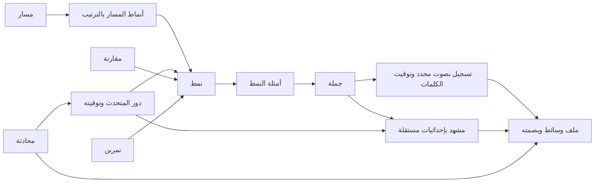

# فهرس محتوى English Patterns

تُحرر نصوص المنهج والوسائط في ملفات المشروع. يقرأ الاستيراد النسخة المبنية من تلك الملفات ويُنشئ فهرس SQLite للاستعلام والتخطيط وإعادة استخدام المشاهد. يستمر المتعلم في تلقي حزم الموقع وملفات الصوت والصور الحالية. تُشغّل قاعدة البيانات عند الحاجة للتحرير والفحص، ولا تدخل في كل طلب من المتصفح.



## التشغيل

```sh
npm ci
npm run build
npm run db:sync
npm run db:summary
npm run db:scene -- this-01
npm run db:scene -- this-01 data/this-01.webp
```

يُنشئ Knex الجداول من `db/migrations` ويقرأ المحتوى عبر `db/seeds`. ملف القاعدة الافتراضي `data/content.sqlite` ويمكن تغييره عبر `EP_DB_PATH`. يحفظ `content_imports` بصمات المصادر، ويحدد `content_state` النسخة المفهرسة. يتجاوز الاستيراد المتكرر إعادة إدراج الصفوف إذا تطابقت البصمات، ويطبق دفعة البيانات الجديدة داخل معاملة واحدة. ملفات الصوت والصور تبقى في مكانها.

## إعادة استخدام المشاهد

لكل مشهد معرّف مستقل في `scenes`، مع مرجع إلى ملف WebP وأبعاد القص وحالة المراجعة. يعرض `scene_usage` الجمل وأدوار المحادثة التي تستدعي المشهد نفسه. يكفي طلب المشهد بمعرّفه أو معرّف الجملة. أمر التصدير يكتب ملف WebP مستقلًا عند الحاجة عبر FFmpeg. بهذه الطريقة تظل الأطالس الأصلية مرجعًا وتبقى كلفة النسخ مرتبطة بالمشاهد المطلوبة فعليًا.

## الإدارة والتوسع

يربط `pattern_terms` الأنماط بالكلمات المفتاحية والأغراض والمجالات، ويربط `sentence_terms` جمل المكتبة بتصنيفاتها. يعرض `coverage_gaps` المشاهد والتسجيلات المفقودة لإعداد خطة الإنتاج. تبقى `editorial_notes` و`external_links` محفوظة عند إعادة استيراد المنهج. تحمل الروابط الخارجية اسم النظام ومعرّفه ومعرّف المحتوى المستقر، ويمكن استخدامها في مرحلة ربط yem1. بيانات المتعلم ومفاتيح حساباته خارج هذه النسخة.

يسجل GitHub Actions كل محادثة في MP3 واحد بصوتي Adam وBella. يحمل `dialogue-audio.json` بصمة الملف وبداية ونهاية كل دور وتوقيت الكلمات على المسار الواحد. يربط الفهرس دور المحادثة بالمشهد والنمط اللذين يستخدمهما. تبدأ مجموعة المحادثات الحالية بمشاهد من المنهج، ويمكن تغيير مشهد أي دور دون إعادة تسجيل النص.
