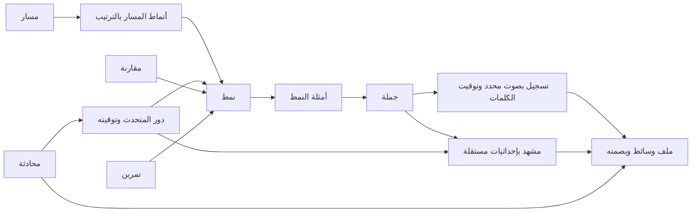

# فهرس محتوى English Patterns

تُحرر نصوص المنهج والوسائط في ملفات المشروع. يستورد Knex المحتوى المبني إلى SQLite باستخدام `better-sqlite3`. عند تشغيل `npm start` يقرأ خادم Node مكتبة مختبر الأفكار من القاعدة مرة واحدة عند الإقلاع ويقدّمها عبر `/api/idea-scenes`. تُخدم الصور والتسجيلات وبقية حزم المنهج من الملفات، ويستخدم المختبر حزمة JSON عند التشغيل الثابت أو دون اتصال.



## التشغيل

```sh
npm ci
npm run build
npm start
```

شغّل الأوامر التالية في طرفية أخرى عند الحاجة للفحص أو التصدير.

```sh
npm run db:sync
npm run db:summary
npm run db:scene -- this-01
npm run db:scene -- this-01 data/this-01.webp
```

يُنشئ Knex الجداول من `db/migrations` ويقرأ المحتوى عبر `db/seeds`. ملف القاعدة الافتراضي `data/content.sqlite` ويمكن تغييره عبر `EP_DB_PATH`. يحفظ `content_imports` بصمات المصادر، ويحدد `content_state` النسخة المفهرسة. يتجاوز الاستيراد المتكرر إعادة إدراج الصفوف إذا تطابقت البصمات، ويطبق دفعة البيانات الجديدة داخل معاملة واحدة. ملفات الصوت والصور تبقى في مكانها.

في استضافة Node ثبّت الحزم بـ `npm ci` في بيئة النشر، ثم استخدم `npm start` أو عيّن `EP_DB_CLIENT=better-sqlite3` إن كان المضيف يشغّل `node server.js` مباشرة. يمكن ضبط المتغيرات من لوحة الاستضافة أو نسخ `.env.example` إلى `.env`. يقبل `EP_DB_CLIENT` حاليًا `better-sqlite3` أو `static`. اترك `PORT` للمضيف. يرتبط وضع SQLite بـ `0.0.0.0` عند وجود `PORT`، أو بعنوان `HOST` عند تعيينه.

في سجل التشغيل ابحث عن `[content-db] ready client=better-sqlite3 idea_scenes=100`. يمكنك أيضًا فتح `/api/health` على نطاق الموقع. القيمة `ideaBackend: "sqlite"` تؤكد أن مختبر الأفكار قُرئ من SQLite عند إقلاع تلك النسخة. القيمة `static` تعني أن الخادم بدأ بالوضع الثابت. إذا كانت الاستضافة تعرض `public/` مباشرة، فسيعمل الموقع من الحزم ولن يكون مسار الصحة متاحًا.

يوجد ملف SQLite على نظام ملفات الخادم خارج `public/`، ويستثنيه Git. للاحتفاظ بالقاعدة بين عمليات النشر، ضع `EP_DB_PATH` داخل وحدة تخزين دائمة يملك الخادم حق الكتابة إليها. إن تعذّر الترحيل أو الاستيراد، يتوقف تشغيل وضع SQLite ويظهر السبب في سجل بدء التشغيل. أعد تشغيل الخادم بعد إعادة الاستيراد لقراءة النسخة الجديدة. حوارات مختبر الأفكار الشخصية تُحفظ في متصفح المتعلم.

## إعادة استخدام المشاهد

لكل مشهد معرّف مستقل في `scenes`، مع مرجع إلى ملف WebP وأبعاد القص وحالة المراجعة. يعرض `scene_usage` الجمل وأدوار المحادثة التي تستدعي المشهد نفسه. يكفي طلب المشهد بمعرّفه أو معرّف الجملة. أمر التصدير يكتب ملف WebP مستقلًا عند الحاجة عبر FFmpeg. بهذه الطريقة تظل الأطالس الأصلية مرجعًا وتبقى كلفة النسخ مرتبطة بالمشاهد المطلوبة فعليًا.

في المختبر تُحفظ المفردات في `idea_scene_words` مع نوع كل مدخل وإحداثيات نسبية من 0 إلى 100 إذا كان له موضع على الصورة. يحفظ `idea_scene_patterns` ترتيب الأنماط المقترحة والأمثلة المرتبطة بالمشهد. عند إضافة مشهد إلى موضوع قائم، ألحق صفه بنهاية ذلك الموضوع في `production/idea-lab-scenes.tsv` للحفاظ على المعرفات. توضع علامات المشاهد بحسب ترتيبها في `production/idea-lab-labels.txt`. يستمر عرض أي مشهد جديد قبل إضافة علاماته.

## الإدارة والتوسع

يربط `pattern_terms` الأنماط بالكلمات المفتاحية والأغراض والمجالات، ويربط `sentence_terms` جمل المكتبة بتصنيفاتها. يعرض `coverage_gaps` المشاهد والتسجيلات المفقودة لإعداد خطة الإنتاج. تبقى `editorial_notes` و`external_links` محفوظة عند إعادة استيراد المنهج. تحمل الروابط الخارجية اسم النظام ومعرّفه ومعرّف المحتوى المستقر، ويمكن استخدامها في مرحلة ربط yem1. بيانات المتعلم ومفاتيح حساباته خارج هذه النسخة.

يسجل GitHub Actions كل محادثة في MP3 واحد بصوتي Adam وBella. يحمل `dialogue-audio.json` بصمة الملف وبداية ونهاية كل دور وتوقيت الكلمات على المسار الواحد. يربط الفهرس دور المحادثة بالمشهد والنمط اللذين يستخدمهما. تبدأ مجموعة المحادثات الحالية بمشاهد من المنهج، ويمكن تغيير مشهد أي دور دون إعادة تسجيل النص.
